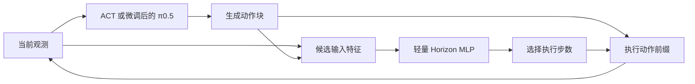

# Adaptive Execution Horizons on SO-ARM101

**面向 ACT 与 π0.5 的轻量 MLP 自适应执行步数研究。**

A research project on selecting execution horizons for chunked robot policies,
with planned ACT and fine-tuned π0.5 deployment on SO-ARM101.

> **项目筹备中 / Research in progress**：本仓库先介绍研究思路并预留资源入口。
> ACT 模型、微调后的 π0.5 模型、正式 MLP 模块、数据和实机对比结果将陆续上传。
> 下文描述的是研究计划，尚未证明成功率、计算开销或任务效率的提升。

## 研究目标

机器人策略通常一次预测一段未来动作，再执行固定数量的动作后重新推理。
较短的执行长度能更频繁地利用新观测，较长的执行长度有机会降低策略调用频率。
本项目希望用一个轻量 MLP 根据当前信息选择执行长度，在保持较高任务成功率的
前提下，减少策略推理次数，并检验实际计算开销和任务完成时间是否改善。

本项目借鉴 **Adaptive Action Chunking for Robotic Imitation Learning** 的思路。
具体继承点、实现差异和创新性分析将在方法与实验确定后补充；原论文的完整引用
将在核对正式版本后添加。

## 核心思路

本项目自适应选择的是 **执行步数**，即执行多少步后重新观察和调用策略。

| 概念 | 含义 |
|---|---|
| `chunk_size` | ACT 或 π0.5 一次生成的未来动作数量 |
| `execution_horizon` | 本轮实际执行的动作前缀长度 |
| Horizon MLP | 预测本轮 execution horizon 的轻量模块 |

基本设想保持策略生成的动作块长度固定，由 MLP 选择其中要执行的前缀；执行完成后
获取新观测，再次推理。MLP 的输入特征、监督标签、候选长度和训练方式仍待实验确定。

ACT 和 π0.5 将分别接入和评估；初期允许各自训练 MLP，不预设共享权重。
这两个策略是两个独立的部署与验证对象。

## 实机任务

平台：**SO-ARM101**。

| 任务 | 场景 | 数据与演示 |
|---|---|---|
| `block_to_box` | 抓取物块并放入盒子 | [上传入口](tasks/block_to_box/README.md)，资源待上传 |
| `pen_to_holder` | 捡起笔并放入笔筒 | [上传入口](tasks/pen_to_holder/README.md)，资源待上传 |
| 后续其他场景 | 按研究进展扩展 | [新场景模板](tasks/_template/README.md) |

每个场景分别预留 ACT、π0.5、MLP 权重、数据、标注、配置、演示与结果位置。
完整目录见 [场景索引](tasks/README.md)；新增场景可复制模板，使用独立任务标识。

演示视频预留在 [media/demos](media/demos/README.md)。后续视频可叠加当前执行长度、
累计策略调用次数、任务用时及最终结果，便于直观看到调度行为。

## 后续上传入口

| 资源 | 位置 | 后续内容 |
|---|---|---|
| ACT 模型 | [models/act](models/act/README.md) | checkpoint、配置、数据版本、模型卡或下载链接 |
| 微调后的 π0.5 | [models/pi05](models/pi05/README.md) | 基础模型来源、微调 checkpoint、处理器、配置及下载链接 |
| MLP 源码 | [research/adaptive_horizon](research/adaptive_horizon/README.md) | 输入特征、标签规则、网络结构、训练与推理模块 |
| MLP 权重 | [models/horizon_mlp](models/horizon_mlp/README.md) | checkpoint、归一化参数、候选长度及适配策略 |
| 物块任务数据 | [data/block_to_box](data/block_to_box/README.md) | 演示数据、划分说明或外部数据集链接 |
| 笔任务数据 | [data/pen_to_holder](data/pen_to_holder/README.md) | 演示数据、划分说明或外部数据集链接 |
| 标注与划分 | [data/annotations](data/annotations/README.md) | episode 划分、阶段标注、标签定义 |
| 评估结果 | [results](results/README.md) | 真实评估日志、汇总表和图表 |

每个模型/任务目录都有一个 `manifest.example.json`，供后续填写资源地址和版本信息。
模型权重与原始数据较大时，建议托管在 Hugging Face Hub 或其他版本化存储中，
在 GitHub 保留模型卡、说明及链接。占位目录不表示相关资源已经发布。

## 实验设想

在两个任务上，分别比较 ACT 与 π0.5 各自的：

- 多组固定执行长度基线；
- 简单规则调度基线；
- MLP 自适应执行长度。

主要观察任务成功率、实际策略调用次数、包含 MLP 与额外特征提取的计算耗时，
以及成功任务完成时间。减少调用次数、节约计算和加快任务完成将分别验证。
训练/验证/测试按完整 episode 划分；失败、中断和人工干预也应纳入评估记录。

| 任务 | 策略 | 成功率 | 推理次数 | 计算耗时 | 任务用时 |
|---|---|---|---|---|---|
| 物块放盒 | ACT | 待评估 | 待评估 | 待评估 | 待评估 |
| 笔放笔筒 | ACT | 待评估 | 待评估 | 待评估 | 待评估 |
| 物块放盒 | π0.5 | 待评估 | 待评估 | 待评估 | 待评估 |
| 笔放笔筒 | π0.5 | 待评估 | 待评估 | 待评估 | 待评估 |

## 当前进度与路线

- [x] 明确研究目标、部署平台和两个任务场景。
- [x] 建立项目介绍、模型/数据/模块占位目录。
- [ ] 整理并上传 ACT 模型及使用说明。
- [ ] 整理并上传微调后的 π0.5 模型及使用说明。
- [ ] 确定 MLP 输入、标签和执行长度选择方式，上传正式模块及权重。
- [ ] 上传可共享的数据、标注与完整 episode 划分。
- [ ] 完成 SO-ARM101 部署、基线对比和实机评估。
- [ ] 上传演示、真实结果和论文复现说明。

当前没有本项目正式的端到端安装、训练或部署命令；将在对应模块上传并验证后补充。

## 基础框架与进一步说明

本地开发基于 [Hugging Face LeRobot](https://github.com/huggingface/lerobot)，完整上游
Git 历史与现有实验代码保留在本地开发工作区。当前展示仓库仅发布项目介绍和资源占位，
保留上游来源说明与 [Apache-2.0 许可证](LICENSE)。本地实验原型尚待整理，后续另行上传。

- [方法设想](docs/method.md)
- [实机配置待补充项](docs/real_robot_setup.md)
- [实验评估设想](docs/evaluation_protocol.md)
- [资源上传与发布说明](docs/publication.md)
- [上游 LeRobot 说明存档](docs/upstream_lerobot_README.md)

ACT 参考：[Learning Fine-Grained Bimanual Manipulation with Low-Cost Hardware](https://arxiv.org/abs/2304.13705)。
π0.5 模型来源、版本与许可将在模型上传时记录；本仓库现有 π0 支持不等同于 π0.5。
研究名称为工作名称，论文标题和正式引用待定。
