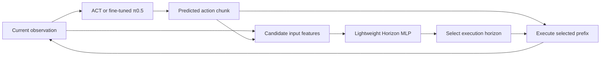

# Adaptive Execution Horizons on SO-ARM101

**English** | [简体中文](README.zh-CN.md)

**Lightweight MLP-based execution-horizon selection for ACT and π0.5.**

A research project exploring adaptive execution horizons for chunked robot
policies, with planned deployment of ACT and fine-tuned π0.5 on SO-ARM101.

> **Research in progress.** This repository currently provides a project overview
> and a published block-to-box dataset. ACT checkpoints, fine-tuned π0.5
> checkpoints, the Horizon MLP module, further datasets, and real-robot comparisons will
> be added as the research progresses. Improvements in success rate, computation,
> and task completion time have not yet been established.

**Dataset available:** [180 block-to-box demonstrations](https://github.com/NeoWang213/adaptive-horizon-so101/releases/tag/dataset-block-to-box-20261110-180) (58,654 frames; two cameras; LeRobot v2.1). See the [download and extraction guide](data/block_to_box/README.md).

## Research objective

Chunked robot policies typically predict a sequence of future actions and
execute a fixed number of them before running inference again. Shorter execution
horizons allow more frequent feedback, while longer horizons may reduce the
number of policy calls.

This project investigates whether a lightweight MLP can select an appropriate
execution horizon while maintaining high task success. We will separately
measure changes in policy-call count, actual computation time, and successful
task completion time.

The project is inspired by **Adaptive Action Chunking for Robotic Imitation
Learning**. A verified citation and a comparison of the inherited ideas,
implementation differences, and potential contributions will be added once the
reference and experimental method have been finalized.

## Core idea

The adaptive quantity is the **number of actions to execute before observing
and invoking the policy again**.

| Term | Meaning |
|---|---|
| `chunk_size` | Number of future actions generated in one ACT or π0.5 prediction |
| `execution_horizon` | Length of the action prefix actually executed before replanning |
| Horizon MLP | Lightweight module that selects the execution horizon |

The proposed approach keeps the generated action-chunk length fixed and uses
an MLP to choose how much of that chunk to execute. After executing the prefix,
the robot obtains a new observation and replans. Input features, supervision,
candidate horizons, and the training procedure remain to be determined through
experiments.

ACT and π0.5 will be integrated and evaluated separately. Separate MLP heads
are allowed initially; shared weights are not assumed.

## Real-robot tasks

Platform: **SO-ARM101**.

| Task | Scenario | Resources |
|---|---|---|
| `block_to_box` | Pick up a block and place it in a box | [180-episode dataset](data/block_to_box/README.md); models and evaluation pending |
| `pen_to_holder` | Pick up a pen and place it in a pen holder | [Task resources](tasks/pen_to_holder/README.md); pending upload |
| Future tasks | Additional scenarios as the research develops | [New-task template](tasks/_template/README.md) |

Each task has dedicated locations for ACT, π0.5 and MLP weights, datasets,
annotations, configurations, demonstrations, and results. See the
[task index](tasks/README.md). New scenarios can reuse the template with a unique
task identifier.

Demonstrations will be linked from [media/demos](media/demos/README.md). Planned
video overlays include the selected horizon, cumulative policy calls, elapsed
task time, and final outcome.

## Resources to be released

| Resource | Location | Planned contents |
|---|---|---|
| ACT models | [models/act](models/act/README.md) | Checkpoints, configurations, data versions, model cards or download links |
| Fine-tuned π0.5 models | [models/pi05](models/pi05/README.md) | Base-model provenance, fine-tuned checkpoints, processors, configurations and download links |
| MLP source code | [research/adaptive_horizon](research/adaptive_horizon/README.md) | Features, labeling rules, network architecture, training and inference modules |
| MLP weights | [models/horizon_mlp](models/horizon_mlp/README.md) | Checkpoints, normalization parameters, candidate horizons and compatible policies |
| Block-to-box data | [data/block_to_box](data/block_to_box/README.md) | Demonstrations, split definitions or external dataset links |
| Pen-to-holder data | [data/pen_to_holder](data/pen_to_holder/README.md) | Demonstrations, split definitions or external dataset links |
| Annotations and splits | [data/annotations](data/annotations/README.md) | Episode splits, phase annotations and target definitions |
| Evaluation results | [results](results/README.md) | Real evaluation logs, summary tables and figures |

Model and task directories include `manifest.example.json` templates for
resource locations and version information. Large weights and raw datasets
can be hosted on Hugging Face Hub or another versioned storage service, with
model cards, documentation, and links retained here. Placeholder directories
do not indicate that artifacts have already been released.

## Planned evaluation

For each task, ACT and π0.5 will each be evaluated against:

- A sweep of fixed execution horizons.
- A simple rule-based horizon selector.
- The MLP-based adaptive execution horizon.

Metrics include task success rate, actual policy calls, computation time
including the MLP and additional feature extraction, and completion time for
successful trials. Fewer policy calls, lower computation, and faster task
completion will be evaluated as separate outcomes.

Training, validation, and test sets will be split by complete episodes. Failed,
interrupted, and human-assisted attempts must also be retained in evaluation
records.

| Task | Policy | Success rate | Policy calls | Compute time | Task completion time |
|---|---|---|---|---|---|
| Block → box | ACT | Pending | Pending | Pending | Pending |
| Pen → holder | ACT | Pending | Pending | Pending | Pending |
| Block → box | π0.5 | Pending | Pending | Pending | Pending |
| Pen → holder | π0.5 | Pending | Pending | Pending | Pending |

## Status and roadmap

- [x] Define the research objective, robot platform, and two initial tasks.
- [x] Prepare the project overview and resource placeholders.
- [x] Publish 180 block-to-box demonstrations and SHA-256 checksums.
- [ ] Release ACT checkpoints and usage documentation.
- [ ] Release fine-tuned π0.5 checkpoints and usage documentation.
- [ ] Finalize MLP inputs, targets, and horizon selection; release the module and weights.
- [ ] Release shareable datasets, annotations, and complete-episode splits.
- [ ] Complete SO-ARM101 deployment, baseline comparisons, and real-robot evaluation.
- [ ] Publish demonstrations, measured results, and paper reproduction instructions.

Project-specific end-to-end installation, training, and deployment commands will
be added after the corresponding modules have been released and validated.

## Foundation and further documentation

Local development is based on
[Hugging Face LeRobot](https://github.com/huggingface/lerobot). Its complete
upstream Git history and existing experimental code remain in the local
development workspace. This presentation repository currently publishes only
the project overview, dataset documentation, and resource placeholders, retaining attribution and the
[Apache-2.0 license](LICENSE). Local experimental prototypes will be organized
and released separately.

The supporting documents and resource placeholder pages below are currently in
Chinese; this project overview is available in both languages.

- [Method proposal](docs/method.md)
- [Real-robot setup: information to be added](docs/real_robot_setup.md)
- [Evaluation proposal](docs/evaluation_protocol.md)
- [Resource upload and publication guide](docs/publication.md)
- [Archived upstream LeRobot README](docs/upstream_lerobot_README.md)

ACT reference:
[Learning Fine-Grained Bimanual Manipulation with Low-Cost Hardware](https://arxiv.org/abs/2304.13705).
π0.5 provenance, version, and licensing will be documented with its release;
existing π0 support is not equivalent to π0.5 integration.
The project name is provisional. The paper title and formal citation are pending.
